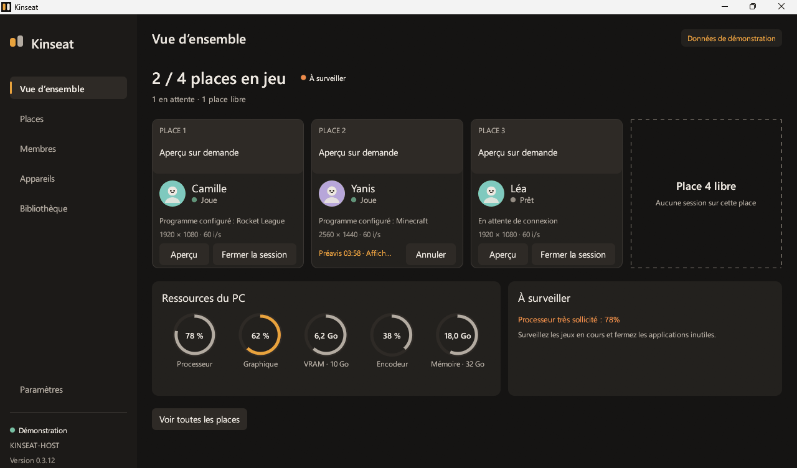
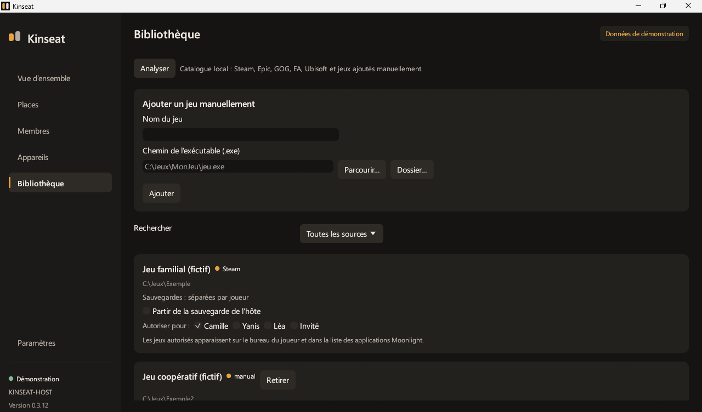

# Kinseat

**Un seul PC de jeu, plusieurs joueurs en même temps.**

Kinseat transforme un PC Windows puissant en console partagée pour la famille ou la maison : chaque joueur reçoit sa propre **place**, c'est-à-dire une session Windows à lui, avec son écran virtuel, son son, sa manette et ses jeux. Il y joue depuis un autre appareil (portable, mini-PC, TV) grâce au streaming, pendant que la personne assise devant le PC continue de l'utiliser normalement.

> État : **préversion** (0.3.x). Kinseat est testé sur un laboratoire de machines virtuelles et sur un vrai PC familial, mais il reste des limites connues, listées dans les notes de chaque version.


*Kinseat Hôte : places en cours, joueurs connectés, ressources du PC. (Capture avec données de démonstration.)*

---

## Ce que fait Kinseat

- **Plusieurs joueurs sur un seul PC** : plusieurs places simultanées, chacune dans sa propre session Windows, en parallèle de la console de l'hôte.
- **Rien à configurer pour le joueur** : il installe *Kinseat Client*, trouve le PC sur le réseau local, demande l'accès et joue.
- **L'hôte garde la main** : il accepte ou refuse les demandes, crée les membres et leurs places, choisit les jeux autorisés, surveille les ressources et peut fermer une session avec préavis.
- **Isolation de chaque joueur** :
  - manettes : chaque manette va à la session de son joueur, pas aux autres ni à la console ;
  - sauvegardes : un jeu lancé par Kinseat écrit dans un dossier propre au joueur, les sauvegardes de l'hôte ne sont jamais modifiées ;
  - bureau : le joueur ne voit que les jeux qu'on lui a autorisés ;
  - Steam : prise en charge d'un Steam séparé par joueur.
- **Bibliothèque de jeux** : détection de Steam, Epic, GOG, EA, Ubisoft, ou ajout manuel d'un exécutable, avec autorisation joueur par joueur.
- **Ressources maîtrisées** : processeur, carte graphique, mémoire vidéo et encodeur sont surveillés ; un profil graphique et un budget de mémoire vidéo sont proposés à la création d'une place.

## Comment ça marche

```
PC hôte (Kinseat Hôte)
├── Console de l'hôte          → la personne devant le PC
├── Place « Camille »  → session Windows + écran virtuel + Apollo → Kinseat Client (portable)
└── Place « Yanis »    → session Windows + écran virtuel + Apollo → Kinseat Client (mini-PC)
```

1. **Kinseat Hôte** s'installe sur le PC de jeu. Il installe et pilote les composants nécessaires : serveur de streaming Apollo, écran virtuel, pilotes de manette virtuelle et d'isolation (ViGEmBus, HidHide), multi-session Windows.
2. Pour chaque membre, Kinseat crée un compte Windows dédié et une **place**, qui démarre sa session et son serveur de streaming.
3. **Kinseat Client** s'installe sur l'appareil du joueur, sans droits administrateur. Il trouve le PC, s'appaire avec un code, puis ouvre le flux avec Moonlight, livré avec le Client.

## Le parcours en images

### 1. Le joueur trouve le PC et demande l'accès


*Kinseat Client liste les PC Kinseat du réseau local. Le joueur clique sur « Demander l'accès ».*

### 2. L'hôte reçoit la demande


*La demande apparaît sur le PC hôte. L'hôte peut créer une place pour ce joueur, ouvrir la liste des places ou refuser.*

### 3. L'hôte crée la place du joueur


*Nouveau membre ou membre existant, code à 4 chiffres ou session sans mot de passe, profil graphique et budget de mémoire vidéo.*

### 4. L'hôte choisit les jeux autorisés


*La bibliothèque regroupe les jeux détectés ou ajoutés à la main. Pour chaque jeu : joueurs autorisés et option « Partir de la sauvegarde de l'hôte ». (Capture avec jeux fictifs.)*

Le joueur est ensuite appairé et lance sa session depuis le Client. Pendant le jeu, **Alt+K** ouvre un menu par-dessus le flux : statistiques, libérer la souris, plein écran ou fenêtré, coller le presse-papiers, réduire, quitter le flux.

## Installation

Téléchargez les installateurs depuis la page des [versions](https://github.com/HatiFlash/kinseat/releases) :

| Fichier | Où l'installer | Droits |
|---|---|---|
| `Kinseat-Host-Setup-<version>.exe` | le PC de jeu | administrateur (une seule demande) |
| `Kinseat-Client-Setup-<version>.exe` | chaque appareil de joueur | utilisateur normal |

Vérifiez les fichiers avec `SHA256SUMS`, publié avec chaque version. Pour mettre à jour, installez la nouvelle version par-dessus l'ancienne, sans désinstaller d'abord.

### Configuration recommandée pour le PC hôte

- Windows 11 (ou Windows 10 récent), 64 bits.
- Une carte graphique avec encodeur matériel (NVIDIA NVENC ou AMD AMF) et assez de mémoire vidéo pour chaque place.
- Au moins 4 cœurs et 4 Go de mémoire vive par place en plus de la console de l'hôte.
- Réseau local filaire ou Wi-Fi 5/6 de bonne qualité.

En cas de problème, les journaux à joindre sont décrits dans [docs/kinseat/journaux.md](docs/kinseat/journaux.md).

## Sécurité et respect du PC hôte

- Kinseat ne supprime jamais un compte qu'il n'a pas créé et ne modifie pas les fichiers de jeux ni les sauvegardes de l'hôte.
- Les places utilisent des comptes Windows dédiés. Un mot de passe « sans mot de passe » est en réalité aléatoire, géré par Kinseat et jamais affiché.
- La multi-session Windows n'est activée que si la version exacte de `termsrv.dll` est reconnue (empreinte SHA-256). Sinon, Kinseat affiche un échec clair au lieu de bricoler.
- L'accès se fait sur le réseau local, après acceptation explicite de l'hôte et appairage par code.

## Limites connues

- Le partage de la carte graphique ne garantit pas une réservation de mémoire vidéo par joueur : Kinseat surveille et prévient, il ne promet pas que tous les jeux tourneront en même temps.
- Les jeux à anti-triche ou à DRM strict peuvent refuser de tourner dans une session secondaire.
- Chaque version liste ses limites et ce qui a été réellement testé dans ses notes de publication.

## Pour les développeurs

| Dossier | Contenu |
|---|---|
| `src/MultiSeat.Service` | service Windows (.NET) : places, sessions, manettes, bibliothèque, IPC d'administration |
| `src/MultiSeat.SteamIsolation` | composant natif (C++) : isolation de Steam et redirection des fichiers de jeux |
| `app/kinseat` | application Kinseat Hôte (Rust, egui) |
| `app/kinseat-client` | Kinseat Client (Rust, egui) et menu Alt+K |
| `app/kinseat-setup`, `app/kinseat-client-setup` | installateurs |
| `installer/` | assemblage des installateurs de version (`build-release.ps1`) |

Contrôles courants : `cargo fmt`, `cargo test`, `cargo clippy` dans `app/`, et `dotnet test` sur `src/MultiSeat.Tests`. Le build complet des installateurs se fait sous Windows.

## Licence

Licence : MIT, voir [LICENSE](LICENSE).

Kinseat s'appuie sur [Apollo](https://github.com/ClassicOldSong/Apollo), [Moonlight](https://moonlight-stream.org/), ViGEmBus et HidHide (Nefarius), ainsi que sur un pilote d'écran virtuel. Leurs mentions de licence sont regroupées dans `installer/licenses/THIRD-PARTY-NOTICES.txt`.
