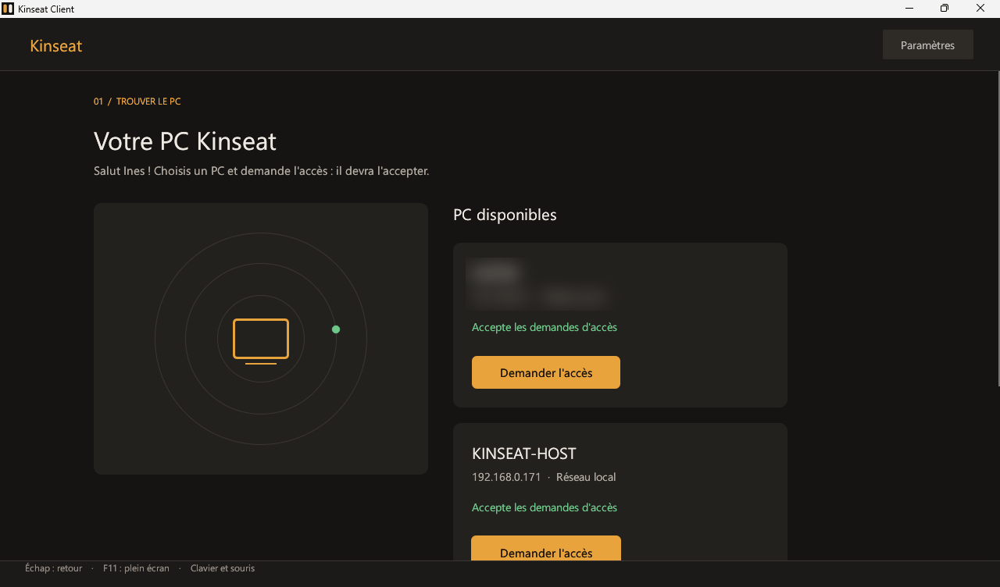
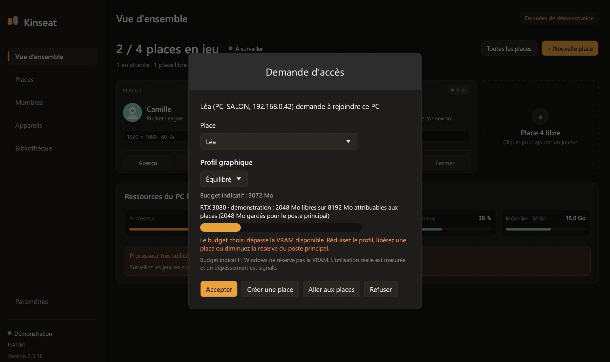
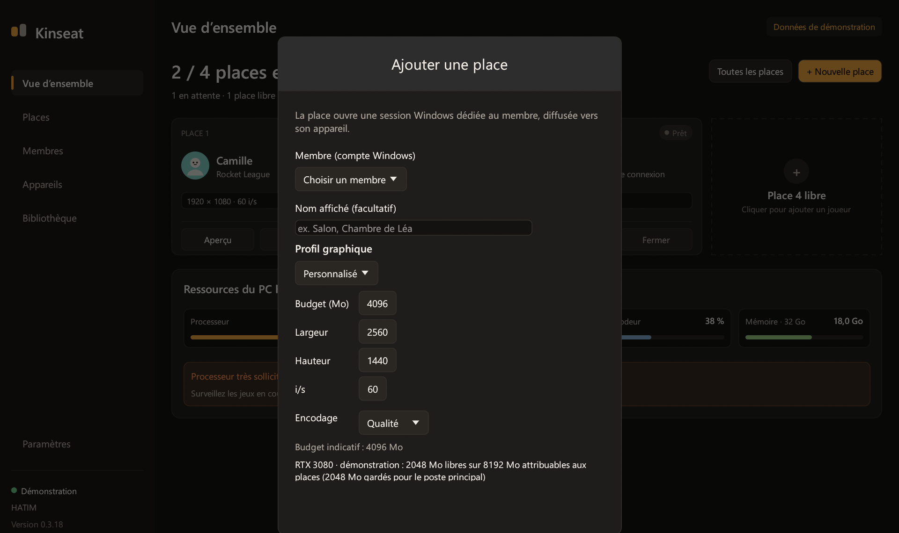

# Kinseat

**Un seul PC de jeu, plusieurs joueurs en même temps.**

Kinseat transforme un PC Windows puissant en console partagée pour la famille ou la maison : chaque joueur reçoit sa propre **place**, c'est-à-dire une session Windows à lui, avec son écran virtuel, son son, sa manette et ses jeux. Il y joue depuis un autre appareil (PC portable, mini-PC Windows x64/ARM64, Linux ou Mac) grâce au streaming, pendant que la personne assise devant le PC continue de l'utiliser normalement.

> Version actuelle : **0.3.18** (préversion). Kinseat est testé sur un laboratoire de machines virtuelles et sur un vrai PC familial ; les limites connues sont listées dans chaque note de version.


*Kinseat Hôte : cartes de places compactes avec télémétrie, ressources du PC unifiées et alertes en direct. (Capture avec données de démonstration.)*

---

## Ce que fait Kinseat

- **Plusieurs joueurs sur un seul PC** : plusieurs places simultanées, chacune dans sa propre session Windows, en parallèle de la console de l'hôte.
- **Rien à configurer pour le joueur** : il installe *Kinseat Client* (Windows x64, Windows ARM64, Linux ou macOS), trouve le PC automatiquement sur le réseau local via le radar animé, demande l'accès et joue.
- **L'hôte garde la main** : il accepte ou refuse les demandes d'accès, crée les membres et leurs places en un clic, choisit les jeux autorisés joueur par joueur, surveille les ressources et peut fermer une session avec préavis.
- **Isolation complète de chaque joueur** :
  - **manettes** : chaque manette va uniquement à la session de son joueur (ViGEmBus + HidHide), pas aux autres ni à la console ;
  - **sauvegardes** : un jeu lancé par Kinseat écrit dans un dossier propre au joueur grâce au moteur natif `Kinseat.GameFiles` — les sauvegardes de l'hôte ne sont jamais modifiées ;
  - **bureau** : le joueur ne voit que les jeux qu'on lui a autorisés ;
  - **Steam** : prise en charge d'une instance Steam isolée par joueur (`Kinseat.SteamLauncher` / `Kinseat.SteamHook`).
- **Bibliothèque de jeux centralisée** : détection automatique de Steam, Epic, GOG, EA, Ubisoft, ou ajout manuel repliable d'un exécutable, avec autorisation joueur par joueur et copie initiale optionnelle de la sauvegarde hôte.
- **Ressources maîtrisées** : processeur, carte graphique, mémoire vidéo (VRAM), encodeur (NVENC/AMF) et RAM sont surveillés en continu avec barres de progression et alertes contextuelles ; un profil graphique et un budget VRAM sont proposés dès la création d'une place.

## Comment ça marche

```
PC hôte (Kinseat Hôte — Windows x64)
├── Console de l'hôte  → la personne devant le PC
├── Place « Camille »  → session Windows + écran virtuel + Apollo → Kinseat Client (Windows / Linux / Mac)
└── Place « Yanis »    → session Windows + écran virtuel + Apollo → Kinseat Client (portable / mini-PC)
```

1. **Kinseat Hôte** s'installe sur le PC de jeu. Il installe et pilote les composants nécessaires : serveur de streaming Apollo, écran virtuel, pilotes de manette virtuelle et d'isolation (ViGEmBus, HidHide), multi-session Windows.
2. Pour chaque membre, Kinseat crée un compte Windows dédié (sans droits administrateur) et une **place**, qui démarre sa session et son serveur de streaming.
3. **Kinseat Client** s'installe sur l'appareil du joueur, sans droits administrateur. Il détecte le PC sur le réseau local, demande l'accès avec suivi animé de l'appairage, puis ouvre le flux avec Moonlight (inclus sur Windows x64).

## Le parcours en images

### 1. Le joueur trouve le PC et demande l'accès


*Kinseat Client détecte automatiquement les PC Kinseat du réseau local. Le joueur clique sur « Demander l'accès ».*

### 2. L'hôte reçoit la demande


*La demande apparaît sur le PC hôte avec choix immédiat de la place, du profil graphique et vérification du budget VRAM.*

### 3. L'hôte crée la place du joueur


*Membre existant ou nouveau membre, code à 4 chiffres ou session sans mot de passe, profil graphique (Éco / Équilibré / Qualité / Personnalisé) et budget VRAM.*

### 4. L'hôte choisit les jeux autorisés


*La bibliothèque regroupe les jeux détectés ou ajoutés manuellement (panneau repliable `+ Ajouter un jeu`). Pour chaque jeu : joueurs autorisés et option « Partir de la sauvegarde de l'hôte ». (Capture avec jeux fictifs.)*

Le joueur est ensuite appairé et lance sa session depuis le Client. Pendant le jeu, **Alt+K** ouvre un menu latéral harmonisé par-dessus le flux : statistiques en grille compacte, libérer la souris, plein écran ou fenêtré, coller le presse-papiers, réduire, quitter le flux.

## Installation

Téléchargez les installateurs depuis la page des [versions (Releases)](https://github.com/HatiFlash/kinseat/releases) :

| Fichier | Plateforme / Rôle | Droits |
|---|---|---|
| `Kinseat-Host-Setup-<version>.exe` | **PC hôte** — Windows 10/11 x64 | administrateur (une seule demande) |
| `Kinseat-Client-Setup-<version>.exe` | **Client** — Windows x64 (Moonlight intégré) | utilisateur normal |
| `Kinseat-Client-Setup-<version>-arm64.exe` / `.zip` | **Client** — Windows ARM64 (installateur ou portable) | utilisateur normal |
| `kinseat-client_<version>_amd64.deb` / `_linux-x64.tar.gz` | **Client** — Linux x64 (Debian/Ubuntu ou portable) | utilisateur normal |
| `Kinseat-Client-<version>-macos-arm64.tar.gz` / `-x64.tar.gz` | **Client** — macOS Apple Silicon & Intel (`.app`) | utilisateur normal |

Vérifiez les fichiers avec `SHA256SUMS`, publié avec chaque version. Pour mettre à jour, installez la nouvelle version par-dessus l'ancienne, sans désinstaller d'abord.

### Configuration recommandée pour le PC hôte

- Windows 11 Pro / Entreprise (ou Windows 10 Pro récent), 64 bits *(Windows Famille n'est pas pris en charge pour les sessions simultanées)*.
- Une carte graphique avec encodeur matériel (NVIDIA NVENC ou AMD AMF) et assez de mémoire vidéo pour chaque place.
- Au moins 4 cœurs et 4 Go de mémoire vive par place en plus de la console de l'hôte.
- Réseau local filaire ou Wi-Fi 5/6 de bonne qualité.

En cas de problème, les journaux à joindre sont décrits dans [docs/kinseat/journaux.md](docs/kinseat/journaux.md).

## Sécurité et respect du PC hôte

- Kinseat ne supprime jamais un compte qu'il n'a pas créé et ne modifie pas les fichiers de jeux ni les sauvegardes de l'hôte.
- Les places utilisent des comptes Windows dédiés sans privilèges administrateur. Un mot de passe « sans mot de passe » est en réalité aléatoire, chiffré via DPAPI (`SYSTEM`) et jamais affiché.
- La multi-session Windows n'est activée que si la version exacte de `termsrv.dll` est reconnue (empreinte SHA-256). Sinon, Kinseat affiche un échec clair au lieu de bricoler.
- Le canal d'administration local (`Kinseat.Admin.v1`) refuse explicitement tout accès réseau (`NetworkSid`), les diagnostics bloquent les liens symboliques et expurgent automatiquement les secrets connus, et l'accès client sur le réseau local exige l'acceptation explicite de l'hôte + un appairage à tentative unique.

## Limites connues

- Le partage de la carte graphique ne garantit pas une réservation stricte de mémoire vidéo par joueur : Kinseat surveille et prévient, il ne promet pas que tous les jeux lourds tourneront en même temps.
- Les jeux à anti-triche noyau ou à DRM strict peuvent refuser de tourner dans une session secondaire.
- Chaque version liste ses limites et ce qui a été réellement testé dans ses notes de publication.

## Pour les développeurs

| Dossier | Contenu |
|---|---|
| `src/Kinseat.Service` | service Windows (.NET 10) : places, sessions, manettes, bibliothèque, IPC d'administration |
| `src/Kinseat.Shared` | modèles et constantes partagés (.NET 10) |
| `src/Kinseat.SteamIsolation` | composant natif (C++) : isolation de Steam (`Kinseat.SteamHook`) et redirection des sauvegardes (`Kinseat.GameFiles`) |
| `src/Kinseat.Tests` | suite de tests unitaires et d'intégration (2 288 tests) |
| `app/kinseat` | application Kinseat Hôte (Rust, egui) |
| `app/kinseat-client` | Kinseat Client multi-plateformes (Rust, egui) et overlay `Alt+K` |
| `app/kinseat-setup`, `app/kinseat-client-setup` | installateurs Windows autonomes |
| `installer/`, `packaging/` | assemblage des installateurs Windows et paquets Linux/macOS |

Contrôles courants : `cargo fmt --all -- --check`, `cargo clippy --workspace --all-targets`, `cargo test --workspace` dans `app/`, et `dotnet test src/Kinseat.slnx`. La CI valide automatiquement `.NET 10`, `Rust`, `C++ (x64/x86)` et `PowerShell 5.1/7`.

## Licence

Licence : MIT pour Kinseat Hôte et le service, voir [LICENSE](LICENSE) (et GPL-3.0 pour `kinseat-client`, compatible avec Moonlight).

Kinseat s'appuie sur [Apollo](https://github.com/ClassicOldSong/Apollo), [Moonlight](https://moonlight-stream.org/), ViGEmBus et HidHide (Nefarius), ainsi que sur un pilote d'écran virtuel. Leurs mentions de licence sont regroupées dans `installer/licenses/THIRD-PARTY-NOTICES.txt`.
